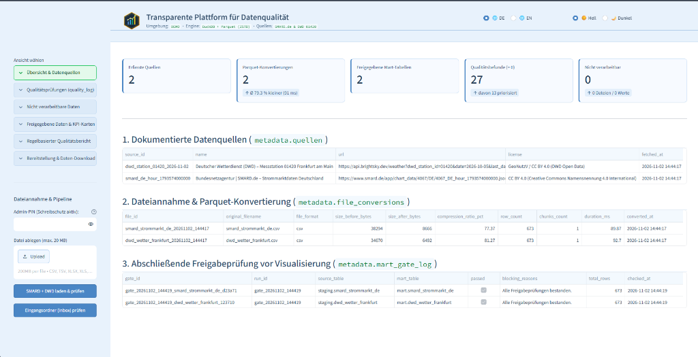
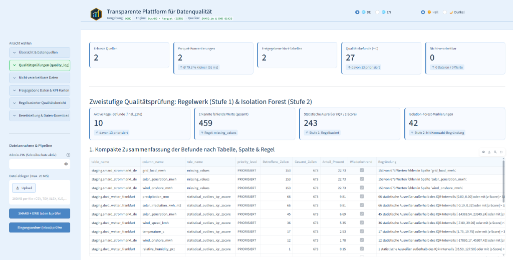
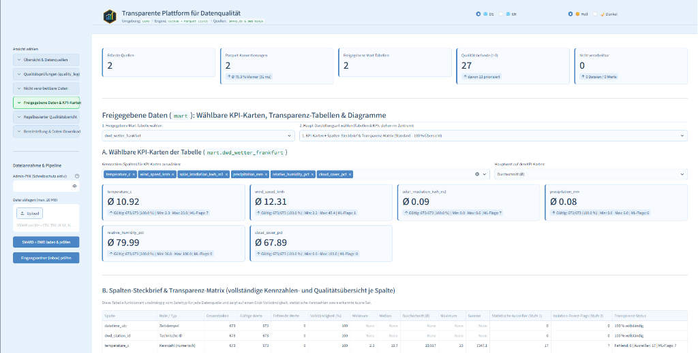
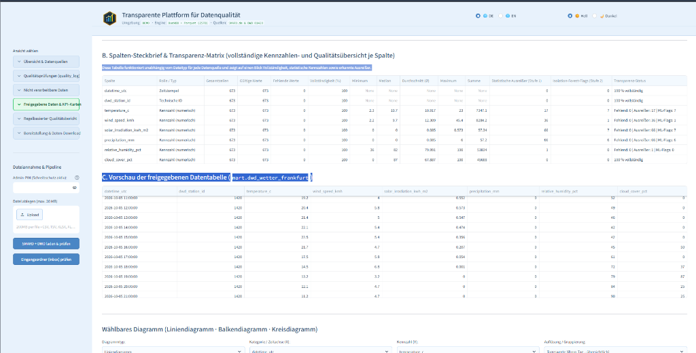
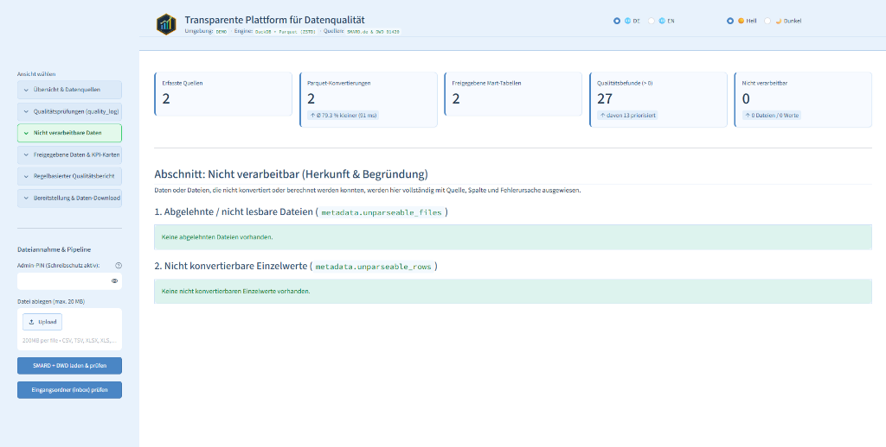
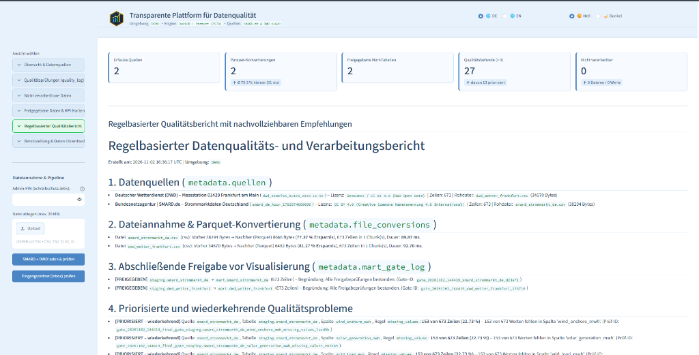
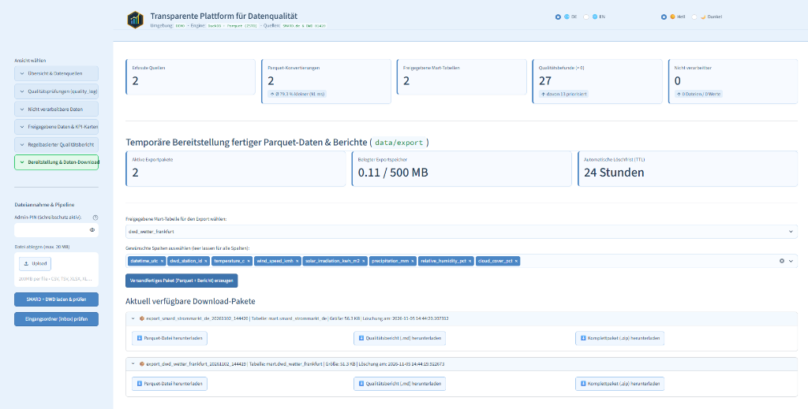
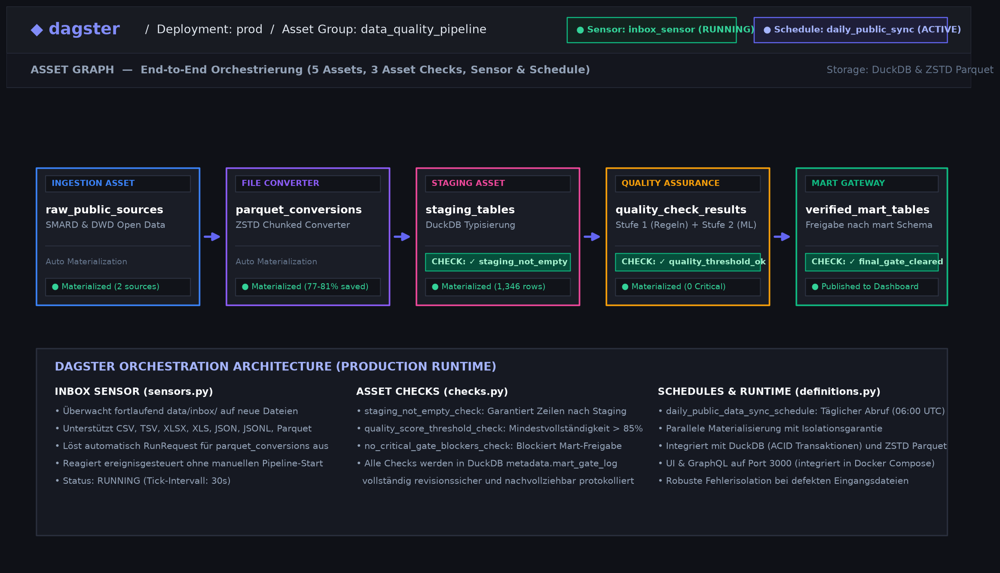

# Transparente Plattform für Datenqualität und Parquet-Verarbeitung

[](https://github.com/alefritz19/data_quality_platform/actions)
[](https://www.python.org/)
[](https://duckdb.org/)
[](https://dagster.io/)
[](LICENSE)

Technische Anwendung zur Dateiannahme, Parquet-Konvertierung (ZSTD) und mehrstufigen Qualitätsprüfung realer, öffentlicher Datensätze mit Python, DuckDB, Dagster und Streamlit.

* **Live-Demo (schreibgeschützt):** [http://89.168.112.220:8503](http://89.168.112.220:8503)

Der Fokus des Projekts liegt auf Nachvollziehbarkeit: Daten werden beim Einlesen nicht stillschweigend verändert oder gelöscht. Stattdessen werden Konvertierungskennzahlen, erkannte Lücken, statistische Auffälligkeiten und nicht verarbeitbare Einträge mit Quelle, Spalte und Ursache in DuckDB-Metadatentabellen protokolliert.

---

## Impressionen der Plattform (DEMO-Laufzeitumgebung)

### 1. Übersicht, Quellenerfassung & Parquet-Konvertierung
Dokumentation der Originalquellen (Bundesnetzagentur / SMARD.de & Deutscher Wetterdienst / DWD), automatisches Chunking, Parquet-ZSTD-Kompression und Freigabeprüfung (`final_gate`).



---

### 2. Zweistufige Qualitätsprüfung (`quality_log` & `Isolation Forest`)
Stufe 1 (Regelwerk) prüft fehlende Werte, Duplikate, Wertebereiche und statistische Ausreißer (`1,5 × IQR`, `|z-Score| > 3,0`). Stufe 2 nutzt Isolation Forest auf Zeitreihen, ohne Daten zu verändern.



---

### 3. Wählbare KPI-Karten, Transparenz-Matrix & Dateneinsicht
Flexibel konfigurierbare Kennzahlenkarten für jede freigegebene Tabelle im Schema `mart`, Spalten-Steckbrief mit Vollständigkeitsgrad und Dateninspektion.





---

### 4. Transparenter Umgang mit nicht verarbeitbaren Einträgen
Dateien oder Einzelwerte, die beim Staging nicht konvertiert werden können, werden gesondert mit Herkunft und Fehlerursache erfasst.



---

### 5. Regelbasierter Qualitätsbericht & Bereitstellung mit automatischer Löschfrist
Automatisierte Erstellung von Markdown-Qualitätsberichten und Bereitstellung fertiger Download-Pakete (`.parquet`, `.md`, `.zip`) mit TTL-Speicherbegrenzung.





---

### 6. Dagster-Orchestrierung (Assets, Sensor & Asset Checks)
Deklarative End-to-End-Pipeline: Der Eingangs-Sensor (`inbox_file_sensor`) erkennt neue Dateien im Verzeichnis `data/inbox`, stößt die ZSTD-Parquet-Konvertierung in Chunks an und leitet Daten über Staging und Qualitätsprüfung bis zur Freigabe in `mart`. Integrierte Asset Checks garantieren Datenintegrität auf jedem Verarbeitungsschritt.



---

## Technischer Aufbau & Funktionen

* **Nachvollziehbare Datenquellen (`metadata.quellen`):** Verarbeitung öffentlicher Originaldaten der Bundesnetzagentur (SMARD.de) und des Deutschen Wetterdienstes (DWD, Messstation 01420 Frankfurt am Main). Jede Quelle wird mit Name, Abruf-URL, Lizenz und Zeitstempel dokumentiert.
* **Dateiannahme & Parquet-Konvertierung (`metadata.file_conversions`):** Überwachter Eingangsordner (`data/inbox`) für `CSV`, `TSV`, `XLSX`, `XLS`, `JSON`, `JSONL` und `Parquet`. Große Dateien werden in konfigurierbaren Chunks verarbeitet und mit ZSTD-Kompression als Parquet gespeichert. Dateigröße vor/nach der Konvertierung, Kompressionsrate und Laufzeit in Millisekunden werden gemessen.
* **Gesonderter Ausweis nicht verarbeitbarer Daten (`metadata.unparseable_files`, `metadata.unparseable_rows`):** Beschädigte Dateien oder einzelne Werte, die sich bei der Typisierung im Staging nicht konvertieren lassen, werden nicht verworfen, sondern mit Rohwert, Zieltyp und Fehlergrund protokolliert.
* **Zweistufige Qualitätsprüfung:**
  1. **Stufe 1 – Regelbasierte Prüfung (`metadata.quality_log`):** Prüfung auf fehlende Werte (`NULL`), Duplikate, unplausible Negativwerte, statistische Ausreißer (IQR-Verfahren `1,5 × IQR` und `|z-Score| > 3,0`) sowie einfache reguläre Ausdrücke für gängige Muster (E-Mail, IBAN, Telefonnummern). Wiederkehrende Befunde werden markiert.
  2. **Stufe 2 – Lernende Anomalieprüfung (`metadata.ml_anomaly_flags`):** Ergänzender `IsolationForest`-Lauf auf numerischen Zeitreihen. Das Modell verändert keine Daten; jede Markierung wird nur zusammen mit der hauptverantwortlichen Spalte, dem beobachteten Wert, dem Spaltenmedian sowie dem z-Score und IQR-Abstand gespeichert.
* **Freigabeprüfung vor Visualisierung (`metadata.mart_gate_log`):** Tabellen werden erst nach bestandenem Prüfschritt (`final_gate`) in das Schema `mart` übernommen und im Dashboard freigeschaltet.
* **Tabellen- und KPI-zentriertes Dashboard (`dashboard/app.py`):**
  * Frei wählbare KPI-Karten für jede freigegebene Tabelle (Durchschnitt, Median, Minimum, Maximum, Summe, Vollständigkeit in %).
  * Spalten-Steckbrief & Transparenz-Matrix mit Kennzahlen und Befunden je Spalte.
  * Aggregierte Tages-/Gruppentabellen, Einzelzeilen-Inspektor (Filter für Lücken und Isolation-Forest-Markierungen) sowie wählbare Linien-, Balken- und Kreisdiagramme.
  * Umschaltbare Oberfläche (Deutsch / Englisch sowie heller und dunkler Modus).
* **Temporäre Datenbereitstellung (`data/export`):** Bereitstellung geprüfter Parquet-Dateien und Markdown-Qualitätsberichte als Download-Paket (`.parquet`, `.md`, `.zip`) mit automatischer Löschfrist (TTL) und Speicherbegrenzung.
* **Getrennte Laufzeitumgebungen (`PROD` / `DEMO`):** Steuerung über Umgebungsvariablen (`APP_ENV`, `DEMO_READ_ONLY`). In der Demo-Umgebung sind Schreib- und Pipeline-Aktionen standardmäßig gesperrt.

---

## Gemessene Laufzeit- und Konvertierungswerte

### 1. Öffentliche Originaldatensätze (SMARD.de & DWD)

| Datensatz (`mart`) | Quelle & Lizenz | Zeilen | CSV (`raw`) | Parquet (`ZSTD`) | Platzersparnis | Konvertierungsdauer |
| :--- | :--- | ---: | ---: | ---: | ---: | ---: |
| `smard_strommarkt_de` | Bundesnetzagentur \| SMARD.de (CC BY 4.0) | 673 | 38.294 B | 8.666 B | **77,37 %** | **89,9 ms** |
| `dwd_wetter_frankfurt` | Deutscher Wetterdienst – Station 01420 (GeoNutzV / CC BY 4.0) | 673 | 34.670 B | 6.492 B | **81,27 %** | **92,7 ms** |

### 2. High-Volume Skalierungs- & Memory-Benchmark (10.000 bis 1.000.000 Zeilen)

Messung des streaming-basierten Chunk-Konverters (`pyarrow.csv` / `pyarrow.parquet` mit ZSTD-Kompression, Level 6) auf Oracle Cloud Server (Ubuntu Linux ARM64, Python 3.12, 4 vCPUs):

| Szenario | Zeilen | Rohdaten (CSV) | Parquet (ZSTD) | Ersparnis | Laufzeit | Durchsatz | Peak-RAM (RSS) |
| :--- | ---: | ---: | ---: | ---: | ---: | ---: | ---: |
| **Kompakt (Demo)** | 10.000 | 0,77 MB | 0,34 MB | **56,0 %** (2,3x) | 0,03 s | 391.224 Z/s (30,2 MB/s) | **137,6 MB** |
| **Multi-Month** | 100.000 | 7,71 MB | 3,22 MB | **58,2 %** (2,4x) | 0,22 s | 451.557 Z/s (34,8 MB/s) | **193,2 MB** |
| **Multi-Year Real-World** | 500.000 | 38,53 MB | 15,82 MB | **58,9 %** (2,4x) | 1,05 s | 475.967 Z/s (36,7 MB/s) | **280,4 MB** |
| **High-Volume Enterprise** | 1.000.000 | 77,06 MB | 31,60 MB | **59,0 %** (2,4x) | 2,14 s | 467.743 Z/s (36,0 MB/s) | **400,7 MB** |

> **Speichereffizienz:** Durch das blockbasierte Streaming (`chunk_size_rows`) bleibt der Speicherbedarf selbst bei 1 Million Zeilen stabil bei ~400 MB RAM. 1 Million Datensätze werden in nur 2,14 Sekunden verarbeitet (~467.000 Zeilen/s).

---

## Projektstruktur

```text
data_quality_platform/
├── .github/
│   └── workflows/
│       └── ci.yml              # GitHub Actions CI Workflow (pytest auf Python 3.12)
├── assets/                     # Screenshot- und Diagramm-Dokumentation
├── tests/                      # Automatisierte Unit-Tests (pytest)
│   └── test_quality_checks.py  # Tests für Lücken, Duplikate und IQR-Ausreißer
├── src/                        # Kernmodule der Pipeline
│   ├── config.py               # Zentrale Konfiguration über Umgebungsvariablen (PROD / DEMO)
│   ├── database.py             # DuckDB-Schemata (metadata, staging, mart)
│   ├── ingest_source.py        # Abruf öffentlicher Datenquellen (SMARD.de & DWD 01420)
│   ├── file_converter.py       # Eingangsordner-Verarbeitung, Chunking & Parquet-Konvertierung
│   ├── staging_loader.py       # Typisierung nach staging & Erfassung nicht konvertierbarer Werte
│   ├── quality_checks.py       # Stufe 1: Regelbasierte Qualitätsprüfungen & quality_log
│   ├── anomaly_model.py        # Stufe 2: Isolation Forest mit Kennzahl-Begründung
│   ├── final_gate.py           # Abschließende Freigabeprüfung vor Übernahme nach mart
│   ├── report_generator.py     # Regelbasierter Qualitätsbericht (Markdown)
│   └── export_manager.py       # Export-Pakete, TTL-Bereinigung & Speicherlimits
├── dagster_app/                # Dagster Orchestrierung
│   ├── assets.py               # Deklarative Software-Defined Assets
│   ├── checks.py               # Asset Checks (Vollständigkeit, Gate-Freigabe)
│   ├── sensors.py              # Inbox File Sensor (automatische Dateierkennung)
│   ├── schedules.py            # Täglicher Abruf-Schedule
│   └── definitions.py          # Dagster Definitions-Einstiegspunkt
├── dashboard/                  # Streamlit-Oberfläche (dashboard/app.py)
├── config/                     # Umgebungsdateien (.env.prod.example, .env.demo.example)
├── docker-compose.prod.yml     # Produktiv-Kontur (Dashboard Port 8502, Dagster Port 3000)
├── docker-compose.demo.yml     # Demo-Kontur (schreibgeschützt, Dashboard Port 8503)
├── requirements.txt            # Python-Abhängigkeiten
└── README.md                   # Projektdokumentation
```

---

## Start & Betrieb

### 1. Schnellstart mit Docker Compose (Empfohlen)

Das Repository enthält vorkonfigurierte Multi-Container-Umgebungen mit definierten Ressourcenlimits und persistenten Volumes:

```bash
# Öffentliche Demo-Umgebung starten (schreibgeschützt, Port 8503):
docker compose -f docker-compose.demo.yml up -d --build

# Produktiv-Umgebung starten (voller Zugriff, Port 8502 & Dagster Port 3000):
docker compose -f docker-compose.prod.yml up -d --build
```

Zum Beenden:
```bash
docker compose -f docker-compose.demo.yml down
# bzw.
docker compose -f docker-compose.prod.yml down
```

---

### 2. Manueller Start über Python Virtualenv

```bash
# Virtuelle Umgebung einrichten
python3 -m venv .venv
source .venv/bin/activate
pip install -r requirements.txt

# Datenabruf und Pipeline manuell durchführen
python3 -m src.ingest_source
python3 -m src.file_converter
python3 -m src.staging_loader
python3 -m src.quality_checks
python3 -m src.anomaly_model
python3 -m src.final_gate
python3 -m src.report_generator

# Hauptversion (PROD) auf Port 8502 starten:
APP_ENV=prod DATA_DIR=./data/prod DEMO_READ_ONLY=false \
  streamlit run dashboard/app.py --server.port 8502

# Demoversion (DEMO, schreibgeschützt) auf Port 8503 starten:
APP_ENV=demo DATA_DIR=./data/demo DEMO_READ_ONLY=true ADMIN_PIN=<eigener_pin> \
  streamlit run dashboard/app.py --server.port 8503
```

---

### 3. Automatisierte Tests (pytest) & CI

Die Unit-Tests prüfen die Qualitätsregeln (`quality_checks.py`) in einer temporären, isolierten DuckDB-Datenbank:

```bash
# Tests lokal ausführen
pytest tests/
```

Bei jedem Push oder Pull Request auf `main` führt der GitHub Actions Workflow (`.github/workflows/ci.yml`) die Tests automatisch aus und aktualisiert das CI-Statusbadge.

---

## Lizenz

MIT License – siehe [LICENSE](LICENSE).
